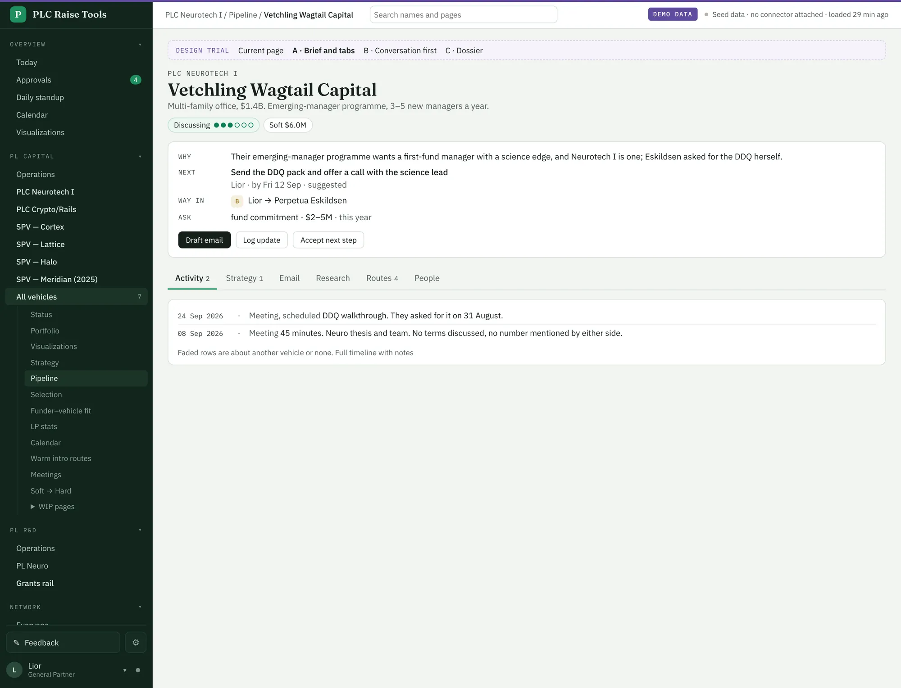
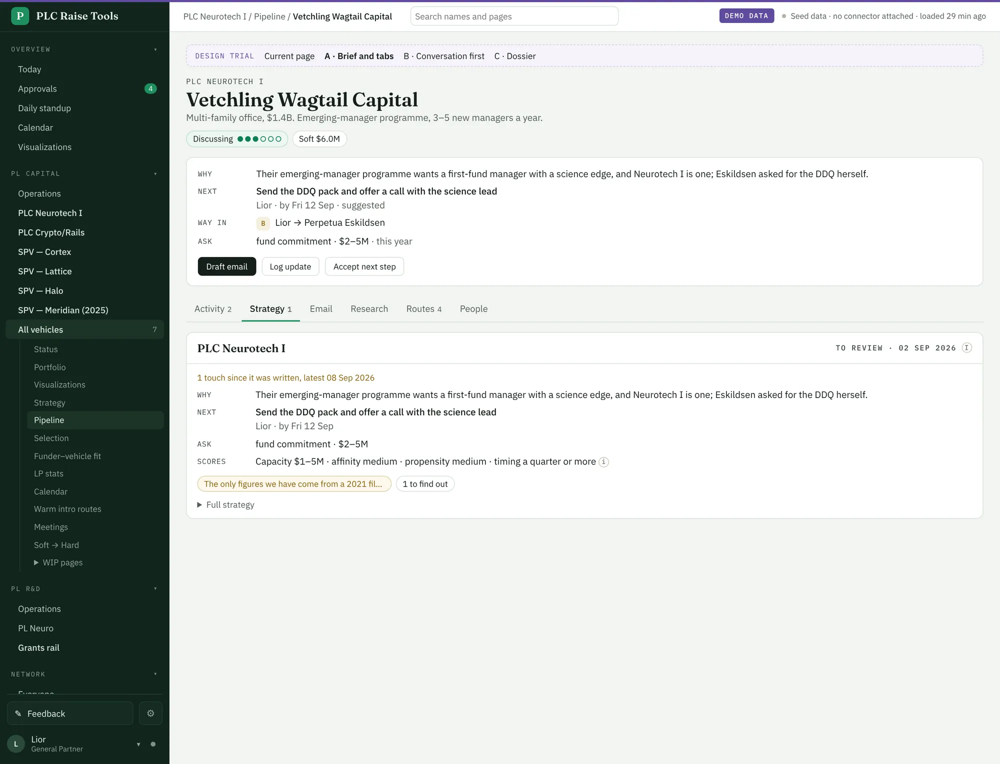
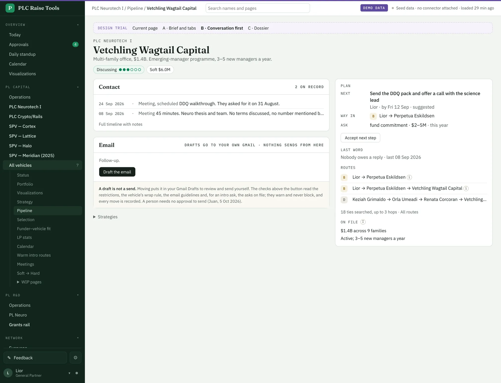
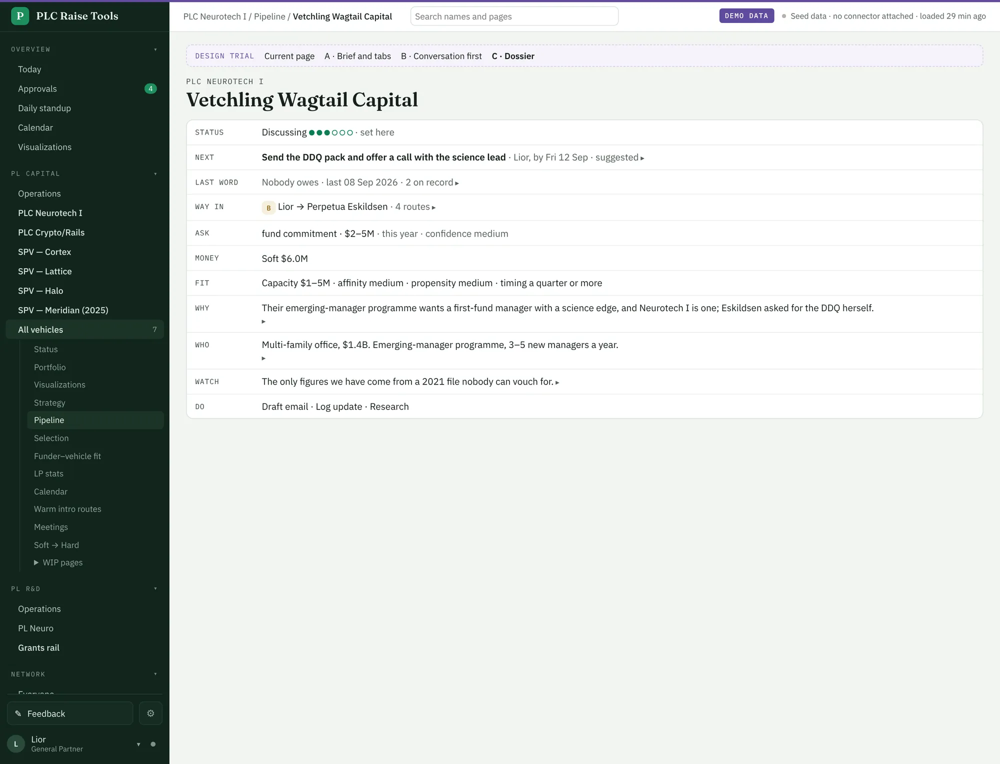
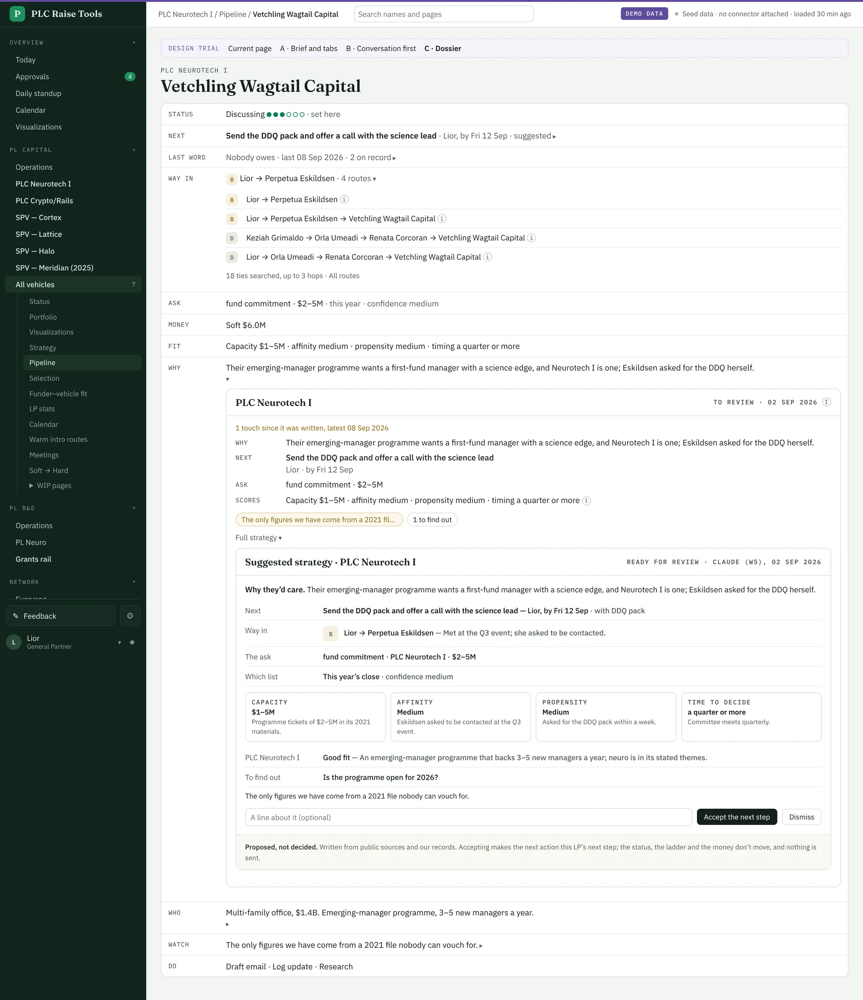
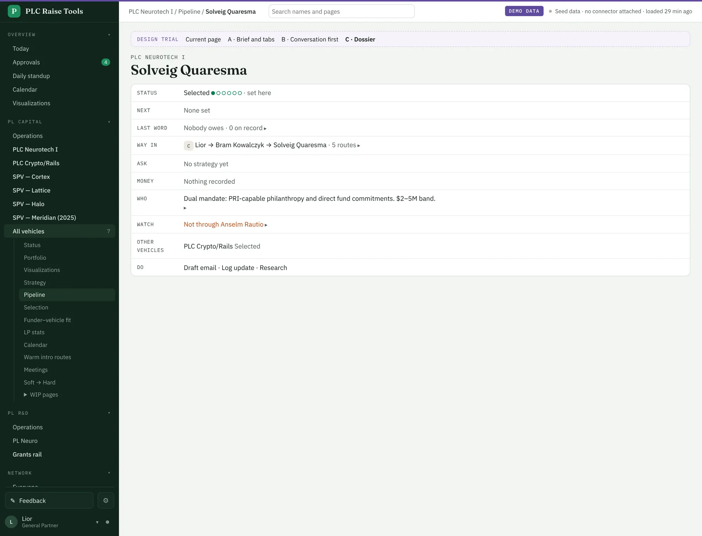
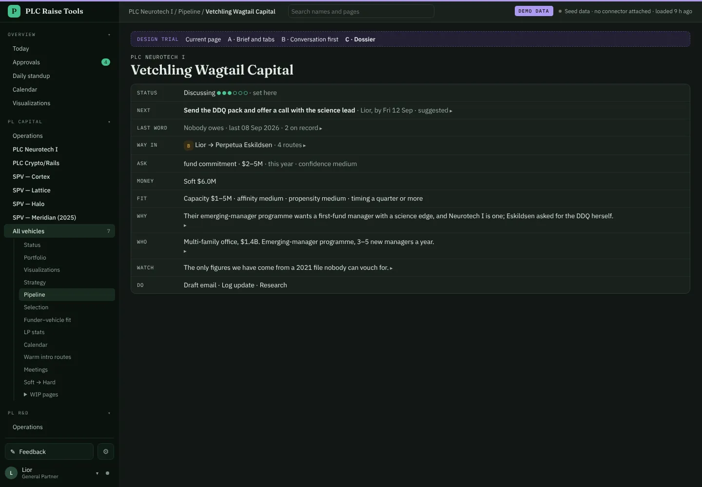
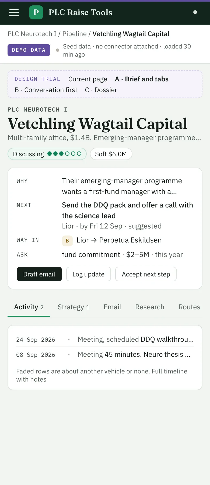
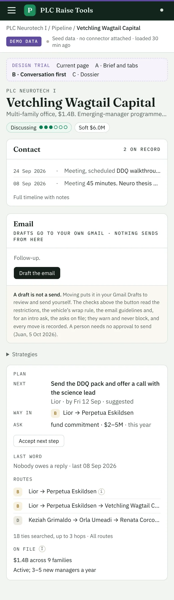

# Three shorter LP pages to compare · 11 Oct 2026

Juan, 11 Oct 2026: "the LP and strategy pages are super verbose ... humans get overloaded with noise", then
"plan out some versions ... under different routes i can visit to compare".

Each LP now has three trial pages beside the current one, reading the same records. Add `/a`, `/b` or `/c` to
any LP address, or use "Try a shorter page" under the name. A bar on each trial page switches between them.

- **A · Brief and tabs**: four lines (why, next, way in, ask) and three buttons, then tabs for Activity,
  Strategy, Email, Research, Routes and People.
- **B · Conversation first**: the thread with them and the email box lead; the plan, who owes, routes and facts
  sit in a narrow column beside them.
- **C · Dossier**: the same rows on every LP, one line each, each opening its detail in place.

All three keep one line per answer, show nothing empty, and keep restrictions in red. The first pass, a plan card
on top of the current page, was withdrawn. Review and calls: `docs/strategy/lp-pages.md`.

