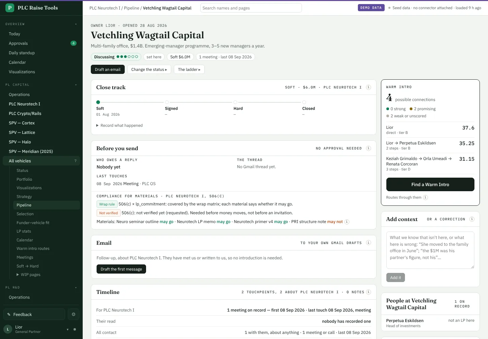
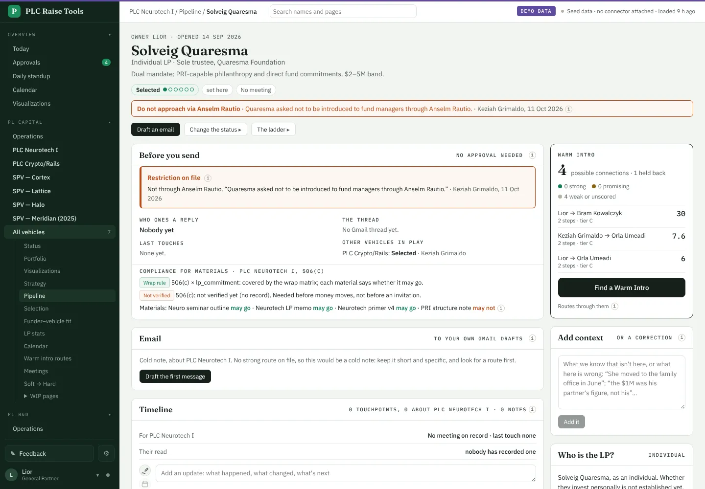
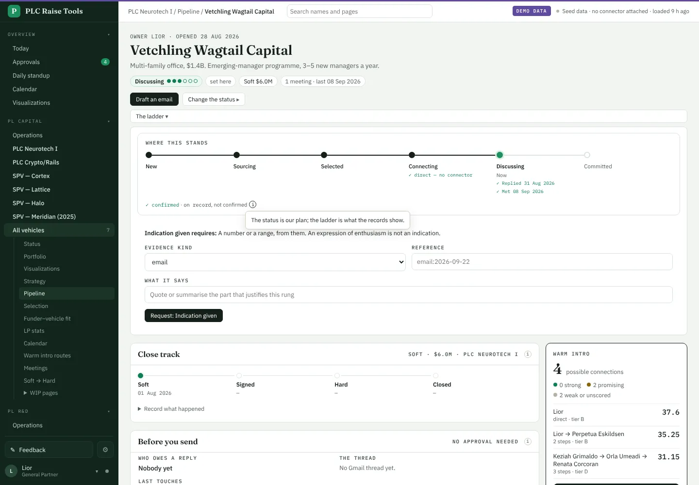
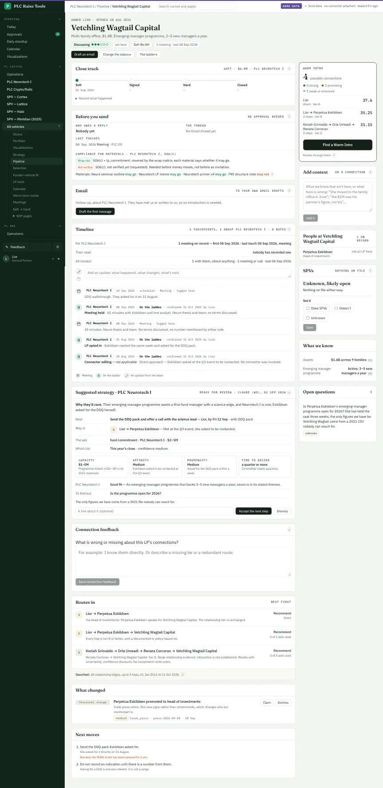
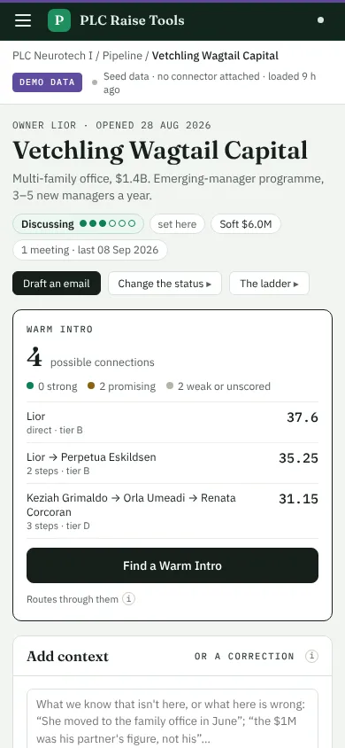
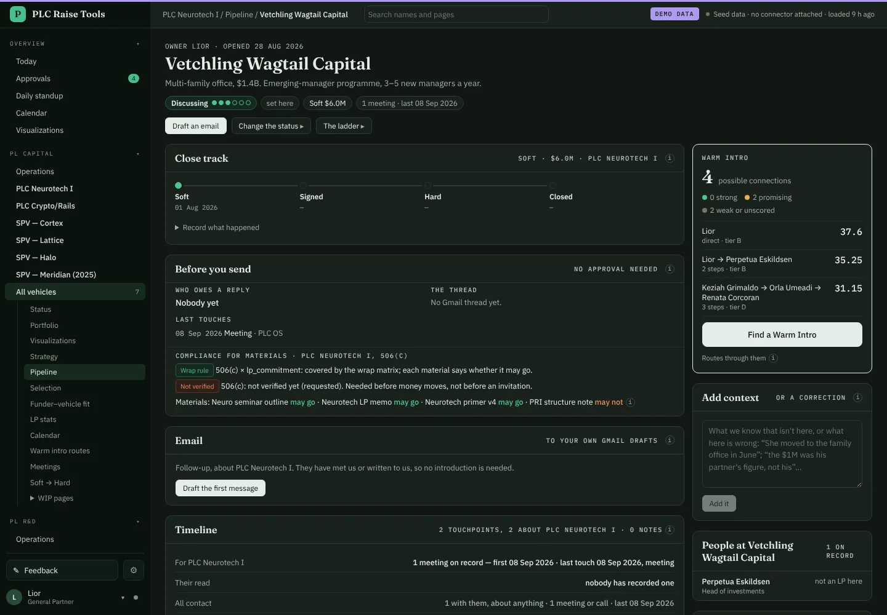
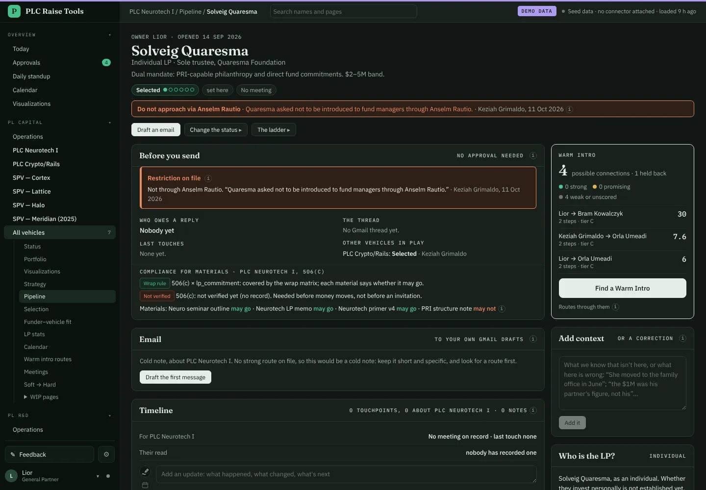

# The LP page, shorter: status in the header, explainers behind an "i" · 11 Oct 2026

Juan, 11 Oct 2026, picking design A: "SGTM -- go for it, lets do this." Step 1 of 3.

- **One header** in place of the status panel, the stepper and the side panel: the name, a two-line
  description, and chips for the status (with its ladder as dots), where it came from, the next step, the money,
  who owes a reply, meetings, their read, needs evidence and the other flags. Long reasons are on hover.
  Restrictions stay in red, under the chips.
- **Change the status** and **The ladder** open in place under the header.
- **Explainers behind an "i"**: "What this covers", "A draft is not a send", "Proposed, not decided", the close
  track and SPV notes, route scores. The coverage line keeps the corpus and dates; the rest is one tap away.
- **Empty cards are gone**: Next moves, What we know and Open questions show only when they have something.

Next: tabs with their own addresses, then shorter strategies from W5. Notes: `docs/strategy/lp-pages.md` §3a.

