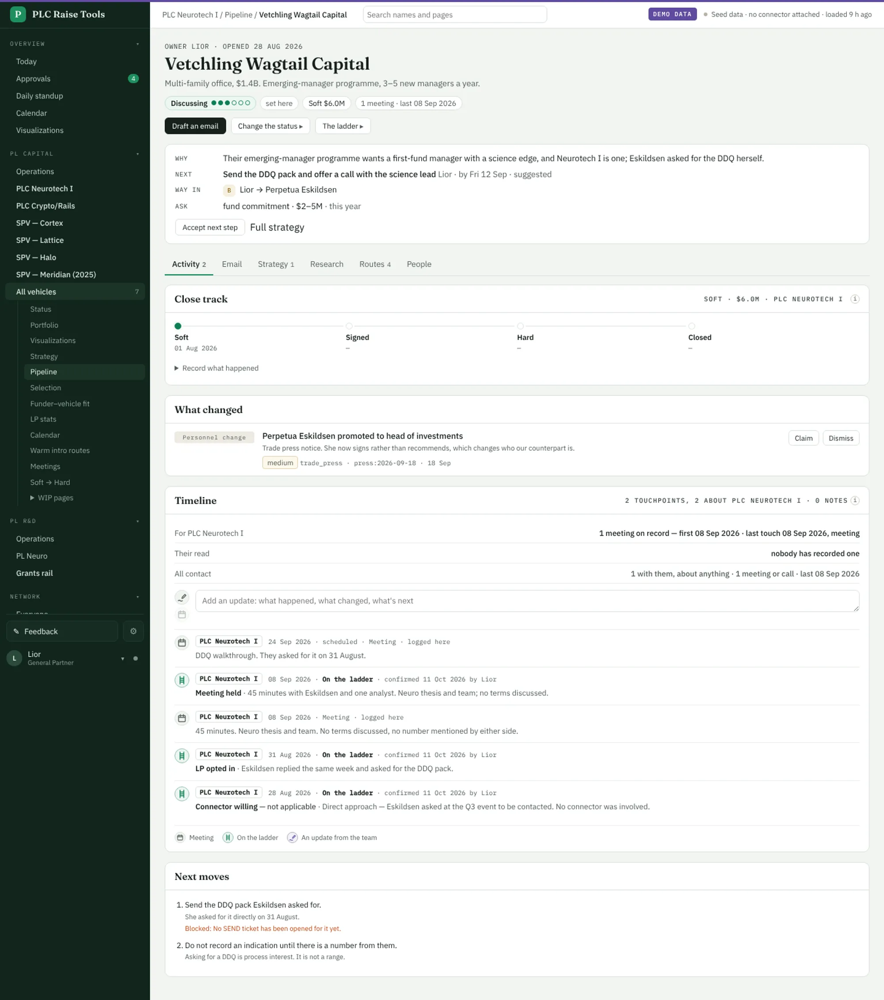
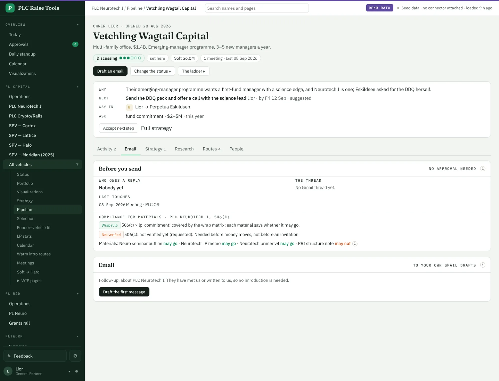
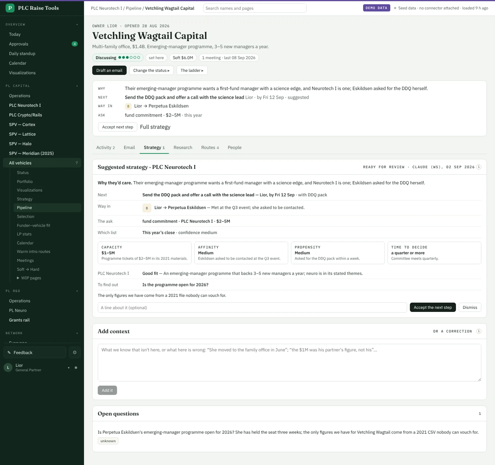
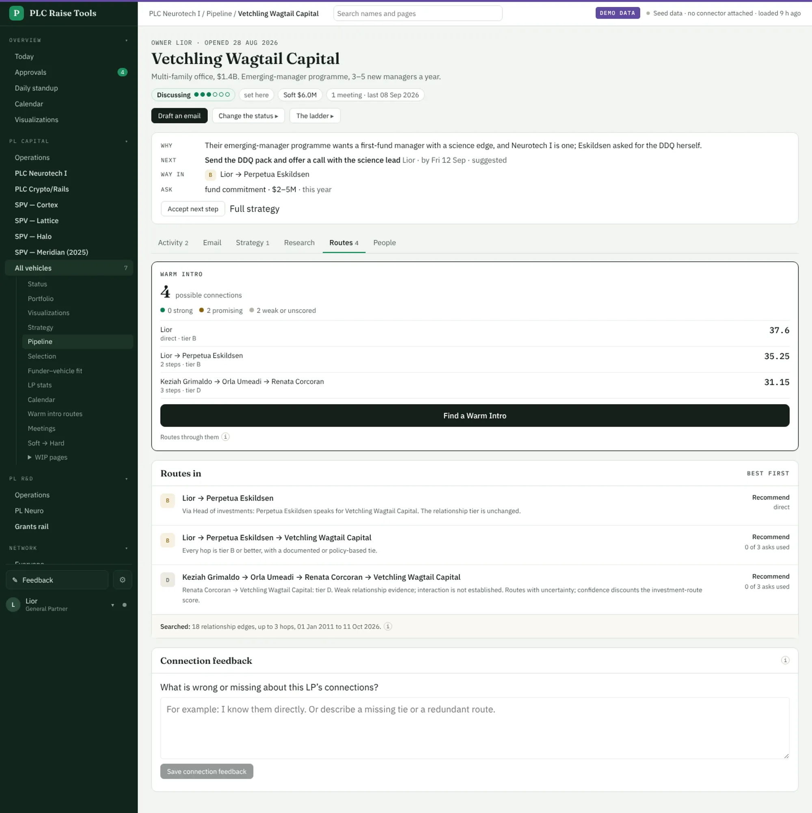
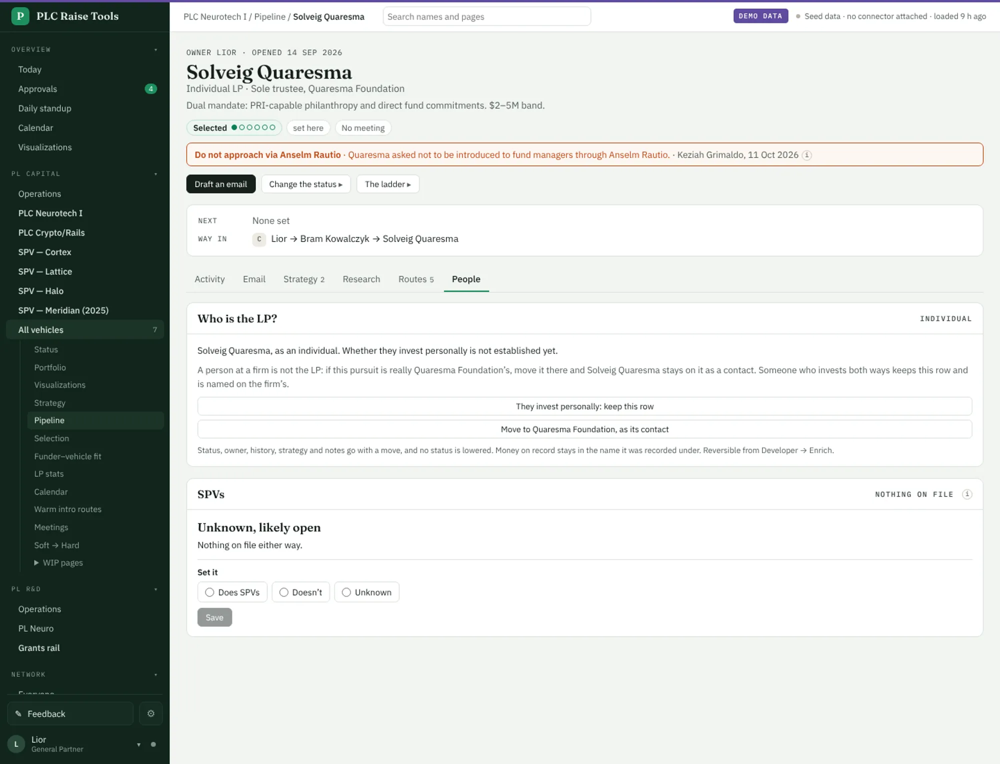
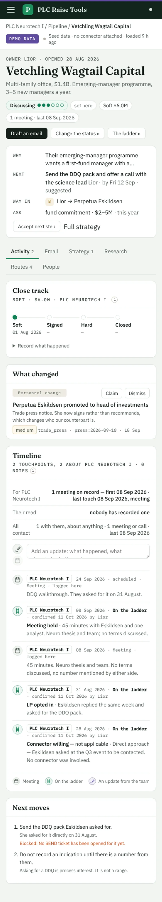
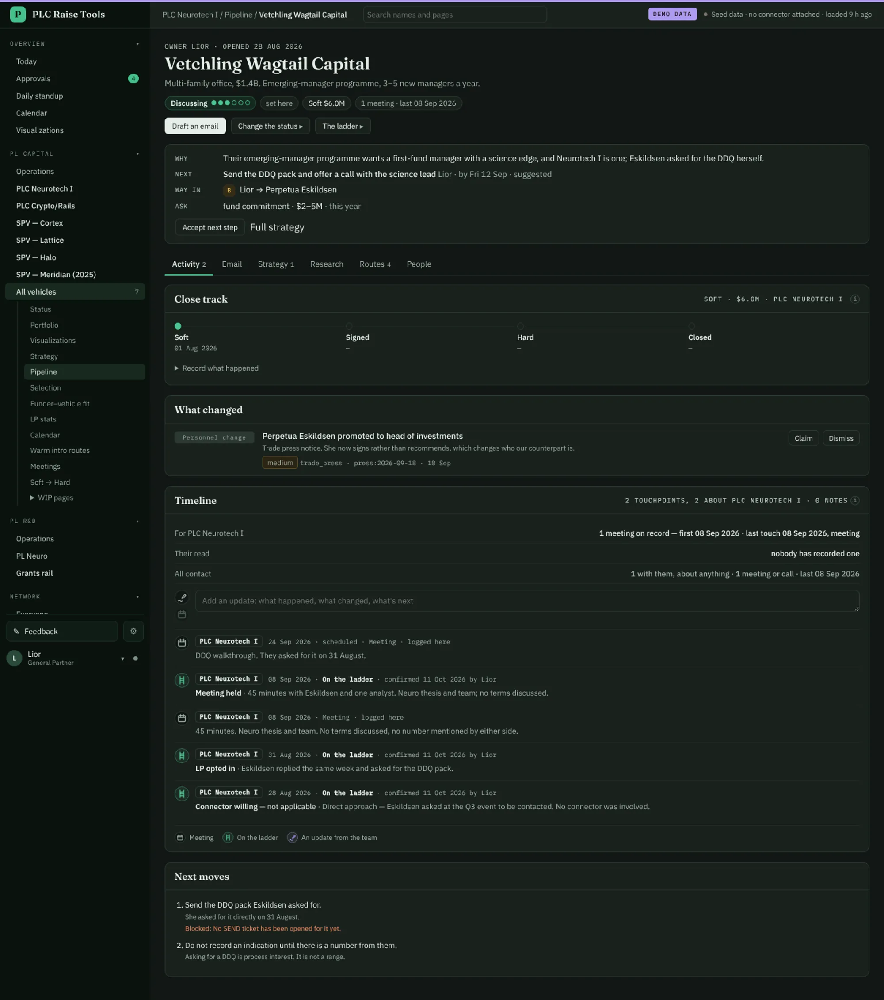

# The LP page in tabs, each with its own address · 11 Oct 2026

Design A, step 2 of 3 (Juan, 11 Oct 2026: "SGTM -- go for it, lets do this").

- **The brief** under the header: why they'd care, the next step, the way in and the ask, one line each. A
  person's next step leads; the strategy's is marked suggested, with **Accept next step** beside it.
- **Six tabs**, each a link you can share: Activity (the page itself: close track, what changed, the timeline,
  next moves), Email (`?tab=email`: Before you send and the drafts), Strategy, Research, Routes and People.
  Only the open tab's cards load.
- **Draft an email** in the header opens the Email tab. The A, B and C trial pages are gone.

Next: W5 writes shorter strategies. Notes: `docs/strategy/lp-pages.md` §3a.

